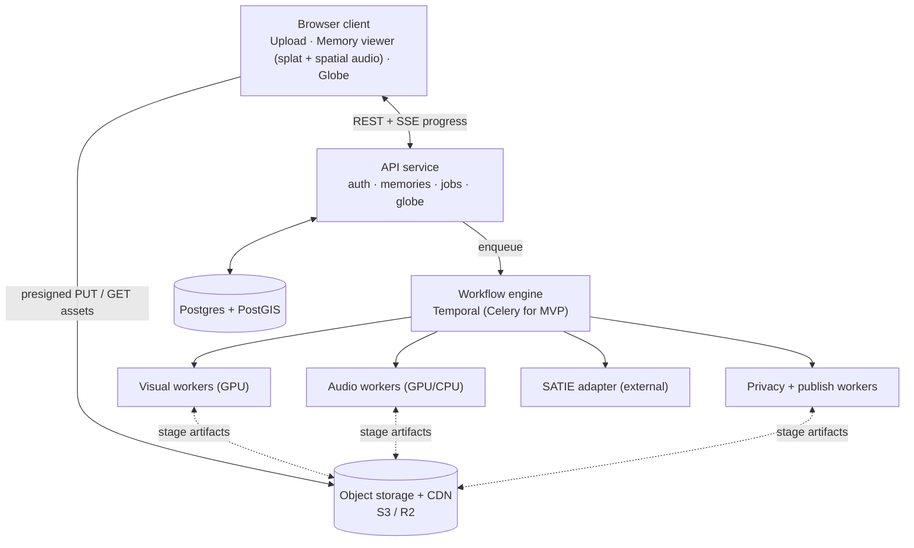
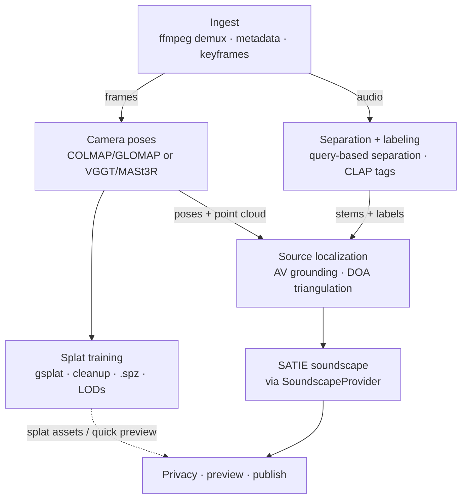

# MemoryScapes Architecture

MemoryScapes turns a video (or a set of panoramic images) plus an audio recording into a **memory**: a Gaussian splat you can walk through, with the recording separated into sources, placed in 3D and rebuilt into a soundscape by SATIE (Attractor Labs). Users can publish memories to a shared globe and explore other people's.

A styled version of this document with diagrams is in [architecture.html](architecture.html). Open it in a browser.

## 1. High-level shape



There are three main parts:

- **Processing pipeline:** a long-running, GPU-heavy, asynchronous workflow (a DAG of jobs).
- **Memory package:** a versioned manifest that ties the splat, the audio sources and the metadata to one shared coordinate frame.
- **Viewer and globe:** both run in the client and stream assets from a CDN.

### Repository layout

| Path | Contents |
|---|---|
| `apps/web` | Next.js client: globe, upload flow, memory viewer, spatial audio engine |
| `services/api` | FastAPI service: auth, memories, presigned uploads, SSE progress, globe queries |
| `services/workers` | Processing pipeline: DAG, one module per stage, SATIE provider adapter |
| `packages/manifest` | Memory manifest JSON Schema + TypeScript types (the pipeline-to-viewer contract) |
| `infra` | Local Postgres/PostGIS, Redis and MinIO via Docker Compose; DB schema |
| `docs` | This document |

## 2. Client (`apps/web`)

| Concern | Recommendation |
|---|---|
| Framework | Next.js or React with TypeScript |
| Splat rendering | Three.js plus **Spark** or **GaussianSplats3D** (WebGL2), with a WebGPU path later. Load progressively, low-LOD splat first. |
| Navigation | First-person walk/fly controls, constrained to a "walkable volume" taken from the camera trajectory so users don't fly into empty floaters. Optional "replay the original path" mode. |
| Spatial audio | Web Audio API. Each separated source becomes a `PannerNode` (HRTF) at its 3D position, plus an ambient bed (ambisonic via Omnitone/Resonance, or stereo). The listener follows the camera. |
| Globe | **globe.gl** or **CesiumJS** (Cesium if you want real terrain). Clustered pins, each with a thumbnail or short preview loop. |
| Upload | Chunked or multipart upload straight to object storage with presigned URLs. Client-side checks: duration, resolution, and whether audio is present. |
| Progress | Server-Sent Events or WebSocket from the API that stream pipeline stage status. |

## 3. API service

FastAPI (`services/api`). Python lines up with the ML workers.

- **Auth:** OAuth or email login through Clerk, Auth0 or Supabase Auth.
- **Endpoints:**
  - `POST /memories`: creates a draft and returns presigned upload URLs.
  - `POST /memories/:id/process`: starts the workflow.
  - `GET /memories/:id`: returns the manifest and status.
  - `GET /memories/:id/events`: SSE stream of stage progress.
  - `PATCH /memories/:id`: updates title, visibility and location.
  - `GET /globe?bbox=&zoom=`: returns clustered public memories.
  - `POST /memories/:id/report`: flags a memory for moderation.
- **Rate and quota limits** per user, because each memory costs GPU minutes.

## 4. Processing pipeline (`services/workers`)

This runs as a workflow DAG. Each stage is idempotent and writes its artifacts to `s3://memories/{id}/{stage}/`, so failed runs can resume.



### 4a. Ingest (`stages/ingest.py`)
- Use ffmpeg to separate the audio (keep the original channel layout and sample rate) from the frames.
- Select keyframes by sharpness (Laplacian variance) and by enough parallax between frames, typically 150–400 frames.
- **Panoramic input:** split equirectangular images into cubemap or perspective crops, or use an SfM tool with spherical camera support (OpenSfM, or COLMAP with rig support).
- Pull GPS and capture time from EXIF or the container metadata to get the globe location. If there is none, the user places the pin.

### 4b. Camera poses (`stages/poses.py`)
- **Quality path:** GLOMAP or COLMAP.
- **Fast path:** a feed-forward model such as VGGT or MASt3R-SfM, which gives poses plus dense points in seconds to minutes and is good for previews.
- Estimate **metric scale**, either from monocular metric depth or from phone IMU/ARKit data if you later ship a capture app. Audio distance attenuation is only believable if the scene's units are meters.

### 4c. Gaussian splat (`stages/splat.py`)
- Train with **gsplat** (Nerfstudio Splatfacto) or a similar trainer on an A10G/L4/A100-class GPU. A few minutes per scene is realistic.
- Post-process:
  - Remove floaters.
  - Crop to the convex hull of the trajectory.
  - Compress to **.spz** or SOG. Raw .ply files run to hundreds of MB, compressed ones to tens.
  - Produce 2–3 LOD levels.
- Optional quick preview: publish a low-iteration splat early so the user sees something within a few minutes.

### 4d. Audio separation and labeling (`stages/separate.py`)
- **Separation:** use a stack of models.
  - General sound-event separation: query-based models such as AudioSep or SAM-Audio-style "separate X" prompts.
  - Speech: a dedicated speech enhancement or diarization model.
  - Music: HTDemucs if music is present.
- **Labeling:** CLAP or BEATs tags each stem (birds, traffic, voices, water and so on). The residual becomes the **ambient bed**.

### 4e. Audio source localization (`stages/localize.py`)

This is the hardest part. Most uploads will be phone recordings: mono or stereo, from a moving mic. There are three possible strategies:

1. **Audio-visual grounding (default):** match each stem's label to objects detected in the frames (Grounding DINO plus SAM), then lift those objects to 3D using the camera poses or splat depth. "Bird" sound maps to the tree region, "voices" to the detected people.
2. **Multichannel direction of arrival (DOA)**, when the recording has spatial audio (stereo, ambisonic or multi-mic): run SRP-PHAT or MUSIC per time window. The mic moves along a known camera trajectory, so bearings can be **triangulated across time**.
3. **Fallback:** unlocalizable stems become diffuse sources or part of the ambient bed, placed around the listener.

The output is a list of `{stem_id, label, position[x,y,z] | trajectory, spread, confidence, gain}` in the splat's world frame.

### 4f. SATIE integration (`stages/soundscape.py`, `providers/soundscape.py`)
- **SATIE always does the spatialization.** It's the default provider, and the viewer plays only SATIE soundscapes. It's isolated behind a **`SoundscapeProvider` adapter**, so its API can change without touching the pipeline. Tests and offline work use `SOUNDSCAPE_PROVIDER=stub`, which gives a memory without sound.
- **SATIE runs through its MCP server** (`https://www.satie.world/mcp`, documented in [Attractor-Laboratories/satie-skills](https://github.com/Attractor-Laboratories/satie-skills)). The adapter follows the skill's workflow:
  1. `satie_inspect_scene`: our placed sources become hosts, at their world positions unchanged (metres, +Y up).
  2. `satie_brief` → `satie_compose`: a generated brief tells SATIE to use the user's own stems as clips named `memory/<id>`. If the script drops a clip, there's one revision round.
  3. `satie_audit_scene` → `satie_realize`: capped by `SATIE_MAX_CENTS` (default 0), with a stable `requestKey` so a retry resumes rather than re-buys.
- **Output:** a `.satie` script plus `samples.json`, played in the viewer by `satie-runtime`, which binds each host at its source's position. Spatialization stays on the client, so free-roaming navigation works. The manifest keeps the sources' positions, which are where the hosts are bound.
- If SATIE fails or would go over budget, the memory still publishes (splat and source positions) without sound. The reason is recorded and shown in the viewer, and re-running the stage tries again.
- **Checked against the live server:** the scene manifest, our stems as `provided` samples at 0¢, and uploads. A worker signs in once with `memoryscapes-worker satie-login`. See `services/workers/README.md`.

### 4g. Privacy and publish (`stages/publish.py`)
- Before anything goes public, **blur faces and license plates in the source frames and retrain**, or mask them in the splat.
- Optionally detect and mute or flag speech, so private conversations don't end up on a public globe.
- Render a thumbnail and a 5-second fly-through preview (MP4/WebP) for globe pins.
- Validate and write the manifest, and invalidate or warm the CDN.

## 5. Memory package (`packages/manifest`)

The manifest is the contract between the pipeline and the viewer. Version it so you can reprocess a memory, for example when the splat trainer improves, without breaking old links. The schema lives in [`packages/manifest/memory.schema.json`](../packages/manifest/memory.schema.json).

```json
{
  "id": "mem_123", "version": 3,
  "coord_frame": { "units": "meters", "up": "+y", "origin_geo": [37.4275, -122.1697, 30], "heading_deg": 0 },
  "splat": { "lods": [{ "url": ".../lod0.spz", "count": 300000 }, { "url": ".../lod1.spz" }] },
  "navigation": { "spawn": {}, "walkable_bounds": {}, "original_path": ".../path.json" },
  "audio": {
    "ambient_bed": { "url": ".../bed.foa.opus", "format": "ambisonic_foa" },
    "sources": [
      { "id": "s1", "label": "birdsong", "url": ".../s1.opus",
        "position": [1.2, 3.4, -5.0], "trajectory": null,
        "ref_distance": 2, "rolloff": 1, "gain": 0.8, "loop": true }
    ],
    "soundscape_provider": { "name": "satie", "job_id": "...", "version": "..." }
  },
  "meta": { "title": "...", "captured_at": "2026-06-01T18:30:00Z", "visibility": "public", "owner": "usr_1" }
}
```

## 6. Data model (Postgres + PostGIS)

See [`infra/db/init.sql`](../infra/db/init.sql).

- `users(id, handle, …)`
- `memories(id, owner_id, title, description, visibility[private|unlisted|public], location geography(Point), captured_at, status, manifest_version, thumbnail_url, created_at)`
- `memory_assets(memory_id, version, kind, url, bytes, checksum)`
- `jobs(id, memory_id, stage, status, attempts, gpu_seconds, error, started_at, finished_at)`
- `reports(id, memory_id, reporter_id, reason, status)`
- Later, for social features: `likes`, `collections`, `follows`.

Use a GiST index on `location` for `bbox` queries. Do server-side clustering (`ST_ClusterDBSCAN`, or precomputed per-zoom tiles) so the globe stays fast at scale.

## 7. Infrastructure

| Layer | Choice |
|---|---|
| GPU workers | Modal, RunPod or AWS Batch/EKS with autoscaling to zero. Jobs are bursty, so serverless GPU fits early on. |
| Queue/workflow | Temporal (durable, retries, long jobs) or Celery + Redis for the MVP |
| Storage/CDN | S3 or Cloudflare R2 + CDN. Use immutable, versioned asset paths. |
| Observability | Per-stage timings and GPU cost, plus Sentry and OpenTelemetry traces through the workflow |
| Cost controls | Per-user quotas, max upload length (for example 2 min), dedupe on content hash |

## 8. Key risks and decisions

1. **Audio localization from phone mono audio** is ill-posed. Lean on audio-visual grounding, and set expectations in the UI ("ambient" vs. "placed" sources).
2. **Splat quality depends on how the user captured the scene.** Add capture guidance (move slowly, orbit, avoid pure rotation) and fail early at the SfM stage with a useful error.
3. **Coordinate alignment:** the splat, the audio positions and the geolocation must share one frame and one scale. Keep this in the manifest from day one.
4. **Privacy on a public globe:** faces, plates, speech and exact home locations. Offer location fuzzing (snap to about 100 m) as a default option.
5. **SATIE dependency:** keep the adapter boundary, and store its raw output so you can re-render without regenerating.
6. **Processing latency:** expect 10–30 minutes end to end. Design the UX around that with notifications, a quick preview splat, and visible stage progress.

## 9. Build phases

1. **MVP:** video upload → COLMAP → gsplat → web viewer with the original audio played non-spatially. Private memories only.
2. **Spatial audio:** separation, audio-visual localization and the Web Audio viewer, with the SATIE adapter stubbed.
3. **SATIE integration**, plus a reprocessing pipeline with versioned manifests.
4. **Globe and sharing:** visibility settings, the PostGIS globe, the privacy pass, moderation and reports.
5. **Polish:** panorama input, a fast feed-forward preview, LOD streaming, and a mobile capture app with IMU/ARKit poses and better audio.
